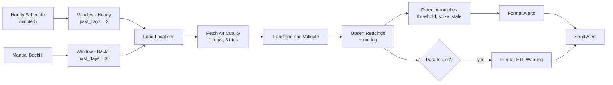
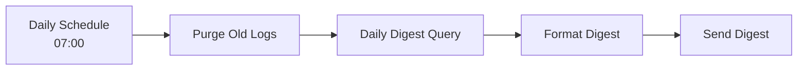
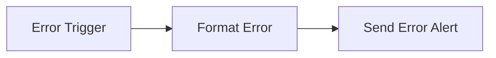
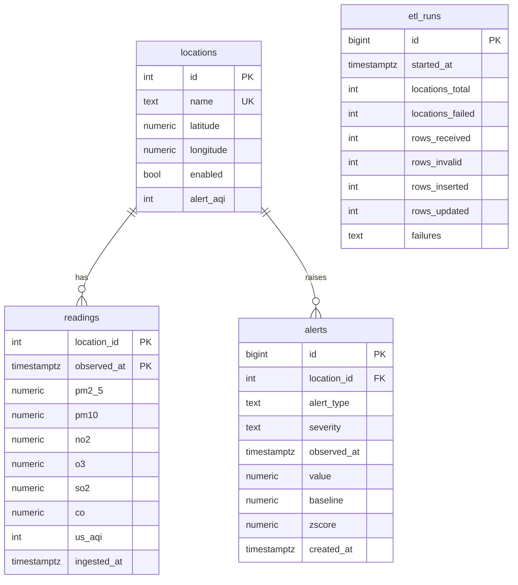

# Air Quality ETL with Anomaly Detection, built with n8n

An n8n workflow that pulls hourly air quality data for the locations you choose, validates it, loads it idempotently into PostgreSQL, detects anomalies with SQL, and reports to Telegram. It is a compact example of a production-style data pipeline: retries, rate limiting, data validation, upserts, a run log, anomaly detection, alert deduplication, a daily digest, and data retention, all in one n8n workflow plus one database.

The data source is the free [Open-Meteo Air Quality API](https://open-meteo.com/en/docs/air-quality-api). The pipeline itself is source-agnostic: swap one HTTP node and one Code node to feed it from your own sensors.

> **Read this first:** the air quality values come from the Copernicus Atmosphere Monitoring Service (CAMS) **atmospheric model**, not from ground sensors. Treat them as modelled estimates, not as measurements for health decisions. See [Data Source and Attribution](#data-source-and-attribution).

---

## Table of Contents

- [Key Features](#key-features)
- [Design Principles](#design-principles)
- [Architecture](#architecture)
- [Tech Stack](#tech-stack)
- [Repository Structure](#repository-structure)
- [Prerequisites](#prerequisites)
- [Installation](#installation)
- [Workflow Configuration](#workflow-configuration)
- [Usage](#usage)
- [Workflow Details](#workflow-details)
- [Anomaly Detection](#anomaly-detection)
- [Database Schema](#database-schema)
- [Data Source and Attribution](#data-source-and-attribution)
- [Security](#security)
- [Testing](#testing)
- [Troubleshooting](#troubleshooting)
- [Limitations](#limitations)
- [Roadmap](#roadmap)
- [License](#license)

---

## Key Features

| Feature | Description |
|---|---|
| **Hourly extract** | PM2.5, PM10, NO2, O3, SO2, CO, and US AQI for every enabled location, fetched at minute 5 of every hour. |
| **Rate limiting and retries** | One request per second, three tries with a 2 second wait, and a failed location never stops the others. |
| **Validation** | Values outside physical ranges become `NULL` and are counted. Forecast hours are discarded. Rows with no valid value are dropped. |
| **Idempotent upsert** | One row per location and hour. A re-run never duplicates data, and only rows whose values really changed are written. |
| **Revision tracking** | The model is re-run regularly, so recent hours can change. The run log records how many rows were inserted and how many were revised. |
| **Run log** | Every run stores locations loaded, locations failed, rows received, invalid values, inserts, updates, and failure reasons. |
| **Three anomaly detectors** | Health threshold (US AQI), statistical spike (robust z-score on a 7-day baseline), and stale data (pipeline health). |
| **No alert spam** | A 6 hour cooldown per location and alert type, plus a unique key per event. A higher severity bypasses the cooldown. |
| **Daily digest** | Every morning at 07:00 Jakarta time: yesterday's average and maximum PM2.5, maximum AQI, hours above the alert level, alert count, and pipeline health. |
| **Backfill** | A manual trigger loads 30 days of history in one click. |
| **Data retention** | Run logs older than 90 days and alerts older than 180 days are purged daily. Readings are kept. |
| **Dashboard-ready** | `latest_readings` and `daily_stats` views for Grafana or Metabase. |
| **Central error alerts** | An Error Trigger branch reports failed executions to Telegram. |

---

## Design Principles

1. **Failures are partial, never total.** One broken location or one invalid value must not stop the rest of the run.
2. **Idempotent by construction.** Primary key, `INSERT ... ON CONFLICT`, and unique alert keys make every step safe to repeat.
3. **Do the heavy lifting in SQL.** Baselines, z-scores, cooldowns, and aggregates run in the database, close to the data, in single atomic statements.
4. **Measure the pipeline too.** The run log and the stale-data detector make pipeline problems visible, not only air quality problems.
5. **Be honest about the data.** Alerts and the digest state that values are modelled estimates.

---

## Architecture

### Flow 1: Extract, validate, load, detect



### Flow 2: Daily digest and retention



### Error handling



---

## Tech Stack

| Component | Purpose |
|---|---|
| [n8n](https://n8n.io) | Workflow orchestration |
| [Open-Meteo Air Quality API](https://open-meteo.com/en/docs/air-quality-api) | Hourly air quality data (CAMS model), no API key needed for non-commercial use |
| PostgreSQL | Readings, run log, alerts, views, and all anomaly math |
| Telegram Bot API | Alerts and daily digest |
| Docker Compose | Self-hosted deployment |

No LLM or paid service is involved.

---

## Repository Structure

```
.
├── README.md
├── sql/
│   └── schema.sql                          # tables, helper function, views, sample locations
└── workflows/
    └── air_quality_etl_anomaly.json        # n8n workflow, ready to import
```

---

## Prerequisites

- Docker and Docker Compose (or an existing self-hosted n8n instance)
- PostgreSQL 13 or newer
- A Telegram bot from [@BotFather](https://t.me/BotFather) and a chat or group for alerts
- A public **HTTPS** URL for n8n only if you want Telegram webhooks elsewhere. This workflow itself only sends messages, so it works behind a firewall.
- Outbound internet access from n8n to `air-quality-api.open-meteo.com`

---

## Installation

### 1. Set up the infrastructure

Example `docker-compose.yml`:

```yaml
services:
  postgres:
    image: postgres:16
    restart: unless-stopped
    environment:
      POSTGRES_USER: n8n
      POSTGRES_PASSWORD: change_to_a_strong_password
      POSTGRES_DB: n8n
    volumes:
      - postgres_data:/var/lib/postgresql/data

  n8n:
    image: docker.n8n.io/n8nio/n8n
    restart: unless-stopped
    ports:
      - "5678:5678"
    environment:
      DB_TYPE: postgresdb
      DB_POSTGRESDB_HOST: postgres
      DB_POSTGRESDB_DATABASE: n8n
      DB_POSTGRESDB_USER: n8n
      DB_POSTGRESDB_PASSWORD: change_to_a_strong_password
      GENERIC_TIMEZONE: Asia/Jakarta
    volumes:
      - n8n_data:/home/node/.n8n
    depends_on:
      - postgres

volumes:
  postgres_data:
  n8n_data:
```

```bash
docker compose up -d
```

Keep the air quality data in its own database:

```bash
docker compose exec postgres psql -U n8n -c "CREATE DATABASE airquality;"
```

### 2. Create the tables

```bash
docker compose exec -T postgres psql -U n8n -d airquality < sql/schema.sql
```

This also seeds five sample locations (Jakarta, Bandung, Surabaya, Medan, Makassar). Edit the `locations` table to match your own (see [Usage](#managing-locations)).

### 3. Create the Telegram bot

1. Send `/newbot` to [@BotFather](https://t.me/BotFather) and save the **token**.
2. Message your bot once (or add it to a group).
3. Get the chat ID from [@userinfobot](https://t.me/userinfobot). Group IDs are negative.

### 4. Create credentials in n8n

| Credential | Main fields |
|---|---|
| Telegram API | Bot token |
| Postgres | Host `postgres`, database `airquality`, user, password |

### 5. Import the workflow

1. In n8n choose **Workflows → Import from File** and select `workflows/air_quality_etl_anomaly.json`.
2. Attach the matching credential to every node that needs one.
3. Replace `REPLACE_WITH_ALERT_CHAT_ID` in **Send Alert**, **Send Digest**, and **Send Error Alert**.
4. Open **Workflow Settings** and set **Error Workflow** to this same workflow.
5. Run **Manual Backfill** once (click the trigger and execute the workflow) to load 30 days of history.
6. Switch the workflow to **Active**.

Spike detection needs at least 48 hours of history per location, so the backfill matters. Without it, spike alerts start about two days after activation.

---

## Workflow Configuration

| Location | Placeholder | Replace with |
|---|---|---|
| **Send Alert**, **Send Digest**, **Send Error Alert** | `REPLACE_WITH_ALERT_CHAT_ID` | Telegram chat ID for alerts |
| All credentialed nodes | `REPLACE_ID` | Select the credentials you created |

Adjustable parameters:

| Parameter | Where | Default |
|---|---|---|
| Run schedule | **Hourly Schedule** | `5 * * * *` (minute 5 of every hour) |
| Hours re-fetched on each run | **Window - Hourly**, `past_days` | 2 days |
| Backfill length | **Window - Backfill**, `past_days` | 30 days (API maximum 92) |
| Request pacing | **Fetch Air Quality**, Batching | 1 request per second |
| Retries | **Fetch Air Quality**, Settings | 3 tries, 2 s wait |
| Physical value ranges | **Transform and Validate**, `LIMITS` | see node |
| Alert level per location | `locations.alert_aqi` | 151 (Unhealthy) |
| Spike rule | **Detect Anomalies**: z >= 3.5 and >= 15 ug/m3 above the median | see SQL |
| Minimum history for spikes | **Detect Anomalies**: `n >= 48` | 48 hours |
| Stale data limit | **Detect Anomalies** | 3 hours |
| Alert cooldown | **Detect Anomalies** | 6 hours |
| Digest time | **Daily Schedule** | `0 7 * * *` |
| Retention | **Purge Old Logs** | runs 90 days, alerts 180 days |

---

## Usage

### Telegram messages

Threshold, spike, and stale-data alerts are grouped into one message per run:

```
AIR QUALITY ALERTS (3)

[HIGH] Jakarta: US AQI 215 (Very unhealthy) at 13 Oct, 14:00 WIB
[MEDIUM] Bandung: PM2.5 spike 28.0 ug/m3 vs typical 12.0 (z=5.4) at 13 Oct, 14:00 WIB
[MEDIUM] Medan: no new data since 13 Oct, 09:00 WIB

Modelled estimates (CAMS via Open-Meteo), not ground sensor readings.
```

A partial pipeline failure sends a warning:

```
ETL WARNING: 1 of 5 location(s) failed to load

- Medan: Request failed with status code 502

Run #318: 96 inserted, 4 updated, 0 invalid value(s) nulled.
```

The daily digest:

```
Air Quality Daily Digest
Mon, 12 Oct 2026

Jakarta: avg PM2.5 31.2 | max 88.0 | max AQI 165 | 7 h above alert level
Bandung: avg PM2.5 12.0 | max 20.1 | max AQI 60
Medan: no data

Alerts in the last 24 h: 3
ETL runs: 24 (1 with failures)
```

### Managing locations

```sql
-- add a location (picked up on the next run; run Manual Backfill to load its history)
INSERT INTO locations (name, latitude, longitude, alert_aqi) VALUES ('Semarang', -6.9932, 110.4203, 151);

-- be alerted earlier for a sensitive location
UPDATE locations SET alert_aqi = 101 WHERE name = 'Jakarta';

-- pause a location
UPDATE locations SET enabled = FALSE WHERE name = 'Medan';
```

### Useful queries

```sql
-- current air quality per location
SELECT * FROM latest_readings ORDER BY us_aqi DESC;

-- daily statistics for the last 14 days
SELECT * FROM daily_stats WHERE day >= current_date - 14 ORDER BY day DESC, name;

-- recent alerts
SELECT l.name, a.alert_type, a.severity, a.observed_at, a.value, a.baseline, a.zscore
FROM alerts a JOIN locations l ON l.id = a.location_id
ORDER BY a.created_at DESC LIMIT 20;

-- pipeline health over the last day
SELECT date_trunc('hour', started_at) AS hour, locations_failed, rows_inserted, rows_updated, rows_invalid, failures
FROM etl_runs WHERE started_at > now() - interval '1 day' ORDER BY started_at DESC;

-- how often does the provider revise recent hours?
SELECT date_trunc('day', started_at) AS day, SUM(rows_inserted) AS inserted, SUM(rows_updated) AS revised
FROM etl_runs GROUP BY 1 ORDER BY 1 DESC LIMIT 14;
```

### Dashboards

Connect Grafana or Metabase to the `airquality` database. Good starting panels:

- Time series of `readings.pm2_5` per location (filter by `observed_at`).
- A table from `latest_readings` colored by `category`.
- A bar chart of `daily_stats.hours_over_alert` per day.
- A pipeline panel from `etl_runs` (failed locations and revised rows).

---

## Workflow Details

| Node | Purpose |
|---|---|
| **Hourly Schedule / Manual Backfill** | Two entry points. The schedule runs at minute 5 of every hour. The manual trigger is for backfills. |
| **Window - Hourly / Window - Backfill** | Set how many past days to request (2 or 30). Re-fetching two days every hour catches late revisions and recovers from short outages. |
| **Load Locations** | Reads enabled locations and passes the window length along. |
| **Fetch Air Quality** | One HTTP request per location with the documented query parameters (`hourly`, `past_days`, `forecast_days=1`, `timezone=UTC`). Batched to 1 request per second, retried 3 times, and set to continue on error so one failure does not stop the run. |
| **Transform and Validate** | Pairs each response with its location, parses UTC timestamps, drops forecast hours, nulls and counts out-of-range values, drops empty rows, de-duplicates, and builds one JSON array plus run statistics. |
| **Upsert Readings** | One statement. Inserts or updates rows (updating only when a value changed), classifies each as insert or revision, and writes the run log row. |
| **Detect Anomalies** | One statement. Computes baselines, finds threshold, spike, and stale-data events, applies the cooldown, stores new alerts, and returns only the new ones. |
| **Data Issues?** | Warns when any location failed in this run. |
| **Format Alerts / Format ETL Warning / Send Alert** | One Telegram message per run for anomalies, and one for pipeline problems. |
| **Daily Schedule / Purge Old Logs / Daily Digest Query / Format Digest / Send Digest** | Retention, then a summary of yesterday in Jakarta time. |
| **Error Trigger / Format Error / Send Error Alert** | Reports failed executions with workflow, node, error, and link. |

---

## Anomaly Detection

All detection runs in a single SQL statement (`Detect Anomalies`) on the latest reading of every enabled location.

### 1. Threshold (health level)

An alert fires when `us_aqi >= locations.alert_aqi` (default 151).

| US AQI | Category | Alert severity |
|---|---|---|
| 0 to 50 | Good | none |
| 51 to 100 | Moderate | none |
| 101 to 150 | Unhealthy for sensitive groups | medium, if `alert_aqi` is lowered to 101 |
| 151 to 200 | Unhealthy | medium |
| 201 to 300 | Very unhealthy | high |
| 301 and up | Hazardous | critical |

### 2. Spike (statistical)

The latest PM2.5 value is compared with the previous 7 days for the same location using a **robust z-score**, which is not distorted by earlier spikes the way a mean and standard deviation would be:

```
median = median of PM2.5 over the previous 7 days
MAD    = median of |PM2.5 - median|
z      = 0.6745 * (latest - median) / max(MAD, 2.0)
```

A spike alert fires only when all of these hold:

- at least 48 hours of history exist,
- `z >= 3.5`, and
- the value is at least **15 ug/m3 above the median**.

The MAD floor of 2.0 stops a very calm series from turning small wiggles into huge z-scores. The absolute floor of 15 ug/m3 stops statistically unusual but practically harmless changes from alerting. Severity is `high` when `z >= 6`, otherwise `medium`.

### 3. Stale data (pipeline health)

An alert fires when an enabled location has no reading newer than 3 hours, or has never had data. This is how you learn that the pipeline, the network, or the API is broken even when no air quality alert would fire.

### Deduplication

- An alert for the same location and type is not repeated for **6 hours**, unless the new alert has a **higher severity**.
- `UNIQUE (location_id, alert_type, observed_at)` guarantees the same event is never stored twice, even after the cooldown.

---

## Database Schema



- `readings` has the primary key `(location_id, observed_at)`, which is what makes every re-run idempotent.
- `aqi_category(int)` is a SQL helper returning the US AQI category name.
- `latest_readings` and `daily_stats` (Jakarta-time days) are views for dashboards.

---

## Data Source and Attribution

- **API:** [Open-Meteo Air Quality API](https://open-meteo.com/en/docs/air-quality-api). Free for **non-commercial** use without an API key. Commercial use requires a paid plan. Read the current terms before deploying.
- **Model data, not measurements.** The values come from the CAMS atmospheric composition models. According to the Open-Meteo documentation, the European domain has a 0.1 degree grid (about 11 km) with hourly steps, and the global domain has a 0.4 degree grid (about 45 km) with 3-hourly steps and updates every 12 hours. For locations outside Europe, such as Indonesia, expect the coarser global data. Nearby cities can show similar values, and hourly values may be interpolated.
- **Revisions.** Because the models are re-run, recent hours can change. The pipeline re-fetches two days on every run, and updates only rows that changed. The `rows_updated` column of `etl_runs` shows how often this happens.
- **Not for health decisions.** For personal or public health guidance use official ground-station data.
- **Attribution is required.** Please credit the CAMS ENSEMBLE data provider and Open-Meteo.com wherever you publish results, for example: *"Air quality data: CAMS ENSEMBLE data provider, via Open-Meteo.com."*

To use your own sensors or another provider, replace **Fetch Air Quality** and adapt the mapping in **Transform and Validate**. The rest of the pipeline only needs rows with the same fields.

---

## Security

- **No secrets in the workflow.** It contains placeholder credential IDs only. Tokens stay encrypted inside n8n.
- **No inbound endpoints.** The workflow only makes outbound calls (the API, Telegram, PostgreSQL), so nothing needs to be exposed to the internet.
- **Parameterized SQL.** The ingested batch is passed as one query parameter and parsed with `json_to_recordset`. Nothing from the API response is concatenated into SQL.
- **Input validation.** Every value is range-checked, timestamps are parsed strictly, and the database enforces coordinate, severity, and alert-type constraints.
- **Least privilege.** Give the PostgreSQL user used by n8n access to this database only.
- **Treat location data as data.** The `locations` table decides which coordinates are requested. Restrict who can write to it.

---

## Testing

What has been verified for this repository:

- **Code nodes: 32 mock-data checks.** Response-to-location pairing, forecast-hour filtering, out-of-range and non-numeric values, all-null rows, failed and malformed responses, de-duplication, timezone suffixes, alert and digest formatting (including never-loaded locations and empty configurations), and workflow structure (retry, rate limit, query parameters, parameter counts, and a check that the Transform output keys match the SQL recordset columns).
- **SQL: 41 checks on a real PostgreSQL engine.** The schema applies twice. Upserts are idempotent and distinguish inserts from revisions, including NULL handling. The run log is written. Spike detection is tested against a seeded 7-day baseline, including the MAD floor, the 15 ug/m3 floor, and the 48-hour history rule. Threshold bands, per-location alert levels, stale and never-loaded locations, cooldown, severity escalation, and unique-event deduplication are all verified. The digest (in Jakarta time), purge, views, and constraints are also covered.

The SQL tests found and fixed one real bug during development: `ROUND(double precision, integer)` does not exist in PostgreSQL, and `percentile_cont` returns `double precision`, so the anomaly query would have failed on every run until the values were cast to `numeric`.

Not covered:

- **The live Open-Meteo API.** Parsing follows the documented response format (`hourly.time` plus one array per variable, `error` and `reason` on failures), but it has not been run against live responses. Run **Manual Backfill** once and inspect the **Fetch Air Quality** output before relying on it.
- **Telegram delivery and n8n node versions.** Verify on your own instance.

---

## Troubleshooting

| Symptom | Likely cause and fix |
|---|---|
| Backfill runs but `readings` stays empty | Inspect the **Fetch Air Quality** output. If it holds an error, check network access to `air-quality-api.open-meteo.com`. If the structure differs from the documented one, adjust **Transform and Validate**. |
| `ETL WARNING` for one location every hour | That location's request keeps failing. Check its coordinates in `locations`, then the error text in the warning. |
| No spike alerts ever | Fewer than 48 hours of history exist, the series is calm, or changes stay under 15 ug/m3. Run the backfill and check `latest_readings`. |
| Constant stale-data alerts | The schedule is not active, the API is unreachable, or the location is new. Look at the latest `etl_runs` rows. |
| The same alert keeps coming back | It should not within 6 hours. Check that the system clock and `GENERIC_TIMEZONE` are correct. Alerts return after the cooldown if the condition persists and the event is new (a newer hour). |
| Many `rows_updated` every run | The provider is revising recent hours, which is expected after a new model run. |
| `rows_invalid` is not zero | Values outside the ranges in `LIMITS` were nulled. Check whether the limits suit your pollutants and units. |
| Nothing is sent to Telegram | Wrong `REPLACE_WITH_ALERT_CHAT_ID`, or the bot was never started or is not in the group. |
| Digest says "no data" for everything | The previous Jakarta day has no readings yet. Run the backfill. |
| Error alerts never arrive | **Workflow Settings → Error Workflow** is not set to this workflow. |
| `relation "locations" does not exist` | `schema.sql` was not run on the database used by the Postgres credential. |
| Version warnings after import | Your n8n version differs. Open the node, re-enter its parameters, or add the node again from the panel. |

---

## Limitations

- **Modelled data.** Coarse resolution outside Europe and no ground truth. Anomalies mostly reflect changes in the model, not local events such as a nearby fire or traffic jam.
- **Latest reading only.** Detection looks at the newest hour per location. If the pipeline was down for several hours, the hours in between are loaded but not individually evaluated.
- **One metric for spikes.** Spike detection uses PM2.5 only. The other pollutants are stored and available for dashboards.
- **No spatial or seasonal modelling.** The baseline is a plain 7-day window. It does not account for daily cycles, weekdays, or seasons.
- **Threshold levels are US AQI.** Local regulations (for example Indonesia's ISPU) use different scales.
- **Single source.** One provider and one request per location.
- **Hourly cadence.** Alerts can lag by up to an hour plus the provider's own latency.
- **Not load-tested.** Designed for tens of locations. For hundreds, use the multi-coordinate request feature of the API and queue mode in n8n.

---

## Roadmap

- [ ] Multi-coordinate requests to fetch many locations in one call
- [ ] Anomaly detection for every pollutant, with seasonal baselines (hour-of-day)
- [ ] Support ground-sensor sources (for example a local sensor network) alongside or instead of model data
- [ ] Indonesian ISPU index and WHO guideline comparisons
- [ ] Forecast storage and forecast-versus-actual error tracking
- [ ] Per-location Telegram channels and quiet hours
- [ ] Weekly trend report with charts
- [ ] Public status page or dashboard export
- [ ] Data quality score per run in the digest
- [ ] Queue mode deployment (Redis and workers) for larger fleets

---

## License

Choose a license that fits your needs (for example MIT) and add a `LICENSE` file to the repository. Remember the data attribution and usage terms of Open-Meteo and CAMS described above.

---

## Contributing

Issues and pull requests are welcome. For larger changes, please open an issue first so the plan can be discussed.
